# CareSync

[](https://github.com/abishekss2007/CareSync/actions/workflows/ci.yml)

One hospital app with a separate workspace for each role. Every department works from the same patient record, so a patient only needs their name or patient ID, and nobody carries paper between departments.

**Live demo:** https://caresync-app-r083.onrender.com (free hosting, so the first visit after a quiet spell takes about a minute to wake up).

Built for an IBM hackathon. It uses **IBM watsonx.ai** for clinical summaries and front-desk routing, and **IBM Cognos Analytics** for leadership dashboards that read the app's data live.

> All patients, staff and visits in this repository are synthetic, generated by `app/seed.py`. No real patient data is used anywhere.

## Contents

- [What it does](#what-it-does)
- [Architecture](#architecture)
- [Roles and access](#roles-and-access)
- [Main flows](#main-flows)
- [Data model](#data-model)
- [IBM services](#ibm-services)
- [Run it](#run-it)
- [Deployment](#deployment)
- [Configuration](#configuration)
- [Tests and CI/CD](#tests-and-cicd)
- [Project layout](#project-layout)
- [Limits](#limits)

## What it does

| Area | Feature |
|---|---|
| Patients | Registration with a generated patient ID and PIN, one record shared by every department |
| Queue | Tokens per department, live position and wait estimate, doctor availability |
| Consultation | Vitals, diagnosis, prescriptions, referral to another department with full history carried over |
| Appointments | Patients book a slot up to 14 days ahead; reception checks them in and a token is issued |
| Beds | Ward map with free, occupied and cleaning states |
| Emergencies | Critical Emergency Alert from the front desk, a banner for the assigned doctor, acknowledgement tracking and automatic escalation |
| Equipment | Doctors request equipment, the dean approves, stores reserve, source, dispatch and track delivery, with maintenance tickets for faulty items |
| Live updates | A server-sent event stream refreshes every open workspace when something it shows changes |
| Approvals | Requests travel nurse to doctor to dean to chairman, with notifications and a trail |
| Tasks and messages | Staff assign work down the hierarchy and message each other |
| Staff accounts | Dean and chairman add staff, disable accounts and reset passwords |
| Analytics | Live KPIs in the app, plus an embedded IBM Cognos dashboard |
| AI | watsonx.ai history summary for doctors and department suggestion for reception |
| Audit | Sign-ins, record views, exports and decisions are logged |
| Themes | Eleven colour themes, switchable from the top bar |

## Architecture

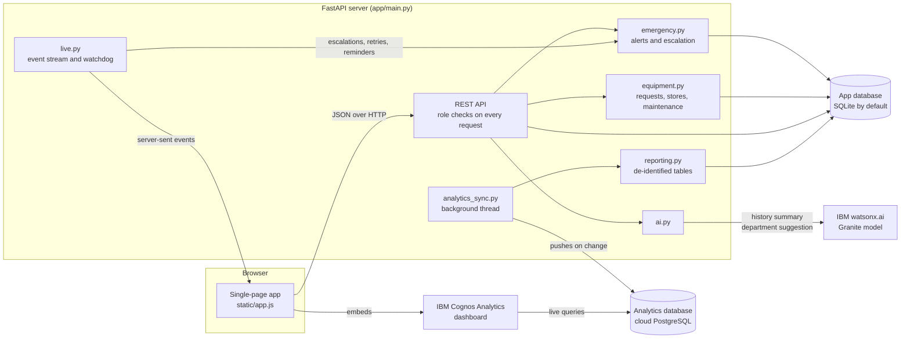

The app keeps its own database for speed. Only the reporting tables, with no names, phone numbers or logins, are copied to the analytics database that Cognos reads.

## Roles and access

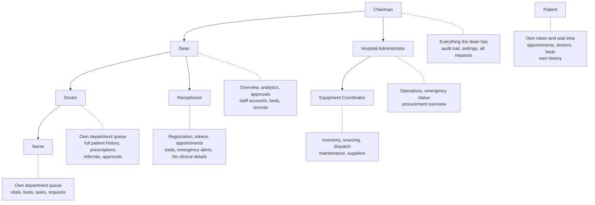

Arrows show who reports to whom. That hierarchy decides who approves requests, who can assign tasks to whom, and which accounts a leader can manage. Every rule is enforced on the server in `app/main.py`; the browser only hides what a role cannot use.

| Capability | Patient | Receptionist | Nurse | Doctor | Coordinator | Admin | Dean | Chairman |
|---|:-:|:-:|:-:|:-:|:-:|:-:|:-:|:-:|
| Own record and token | ✓ | | | | | | | |
| Book appointments | ✓ | | | | | | | |
| Register patients, issue tokens | | ✓ | | | | | | |
| Raise a Critical Emergency Alert | | ✓ | ✓ | ✓ | | | | |
| Clinical history | | | ✓ | ✓ | | | ✓ | ✓ |
| Consult, prescribe, refer | | | | ✓ | | | | |
| Request equipment | | | | ✓ | | | | |
| Approve equipment requests | | | | | | | ✓ | |
| Stores, sourcing and dispatch | | | | | ✓ | ✓ | | |
| Manage beds | | ✓ | ✓ | | | | ✓ | ✓ |
| Analytics and exports | | | | | | | ✓ | ✓ |
| Manage staff accounts | | | | | | | ✓ | ✓ |
| Audit trail and settings | | | | | | | | ✓ |

Two more staff roles support emergencies and equipment. The **Hospital Administrator** (`admin`) sees operations, emergency status (patient details restricted to the patient ID), the procurement overview and can run the stores view. The **Equipment Coordinator / Stores Manager** (`coordinator`) runs inventory, sourcing, dispatch and maintenance. Emergency alerts can be raised by reception and clinical staff; equipment requests are raised by doctors and approved by the dean.

## Main flows

### One patient, two departments, no paper

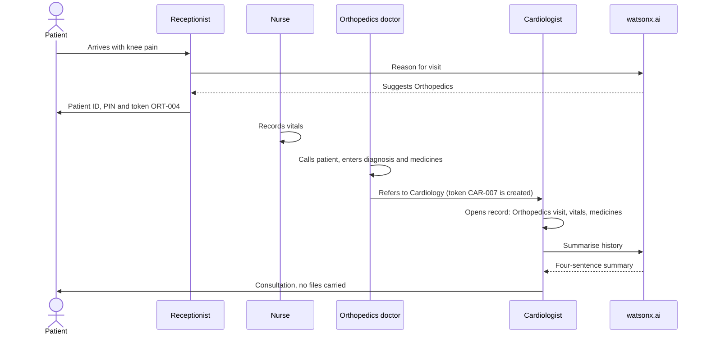

### Critical emergency alert

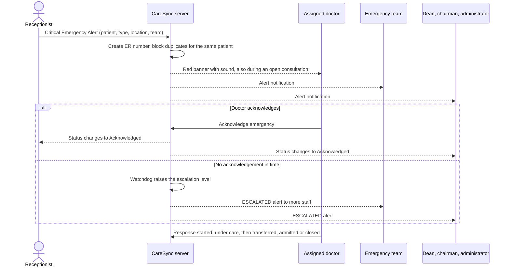

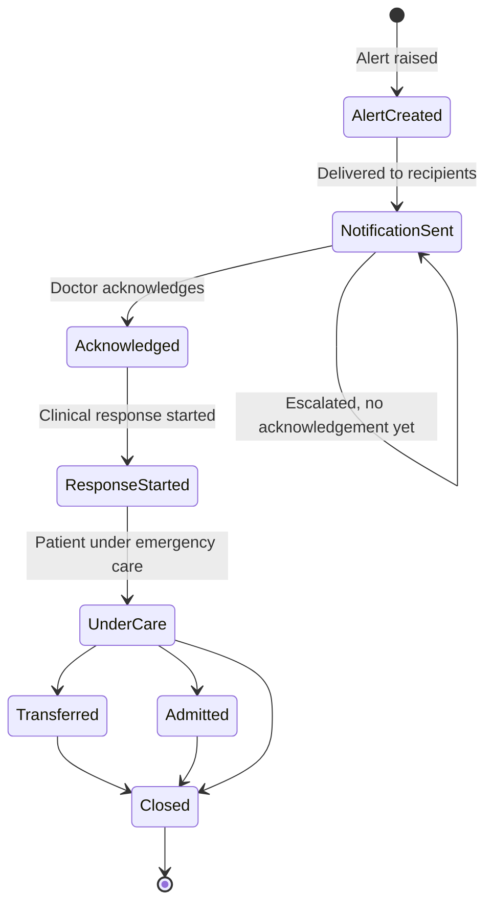

Delivery and acknowledgement are tracked separately, so the front desk can tell "the doctor's screen received it" from "the doctor said they are responding". The administrator sees emergency status with the patient reduced to the patient ID.

### Equipment request to delivery

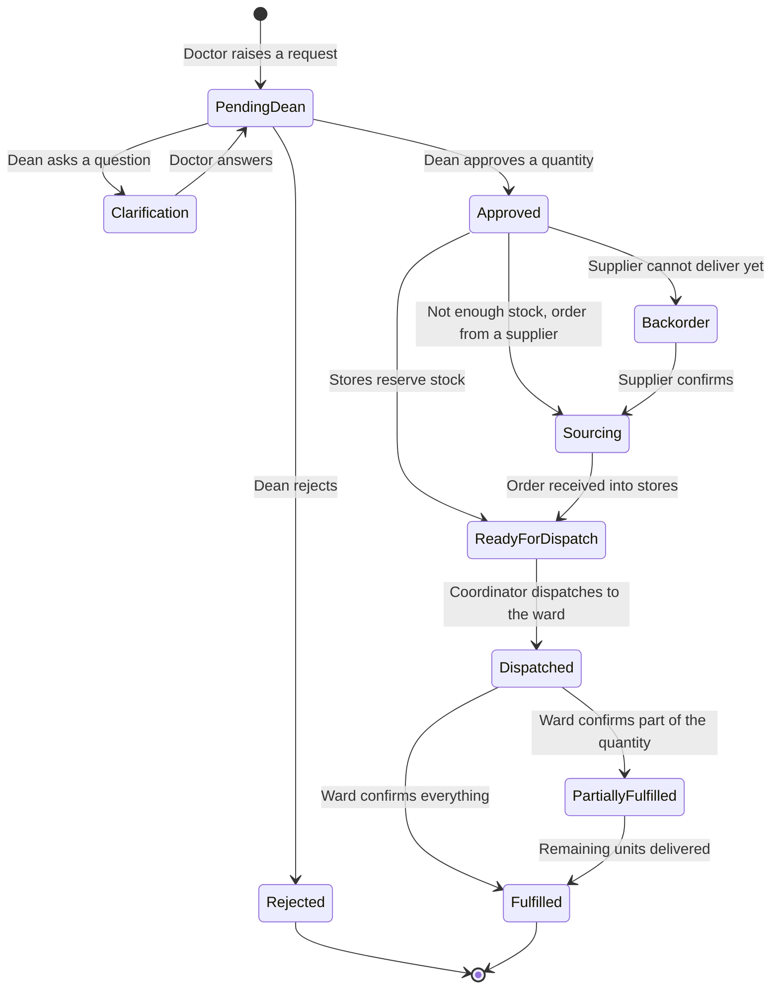

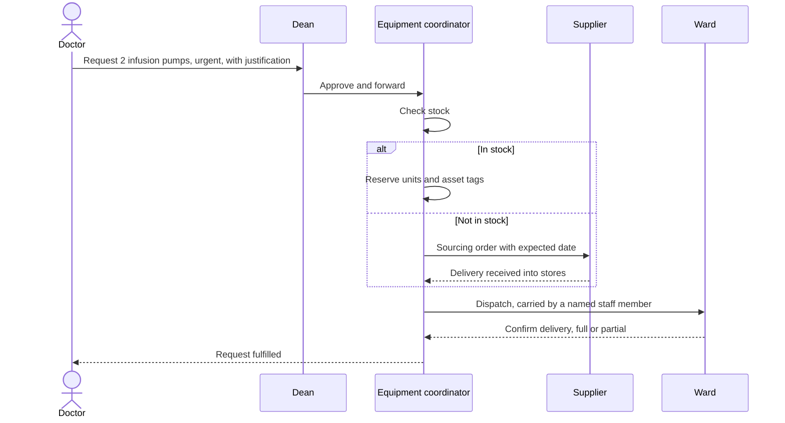

Reserved units are held for one request and are no longer offered to anyone else. Faulty equipment goes through a separate maintenance ticket (reported, technician assigned, scheduled, in progress, awaiting verification, completed), and unsafe items are taken out of use until verified.

### Approval chain

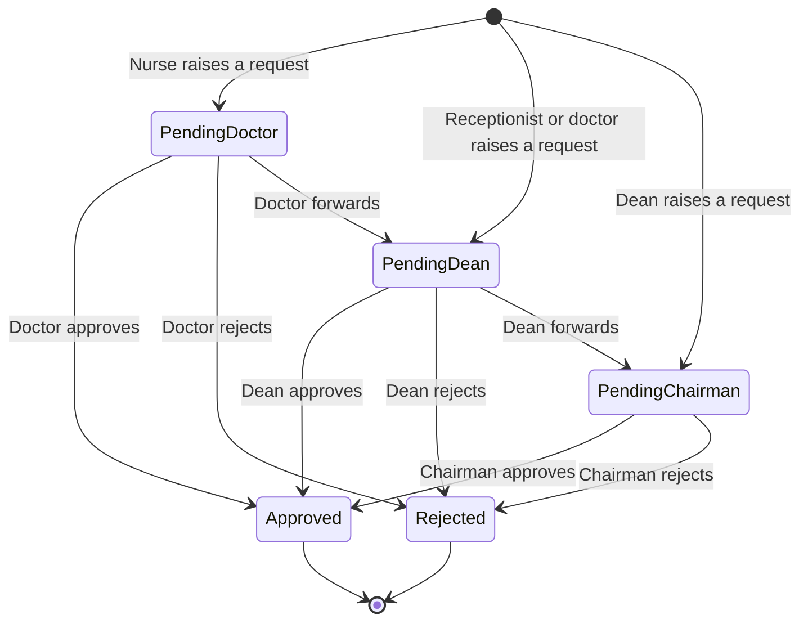

Each step notifies the people involved and is added to the request's trail.

### Appointments

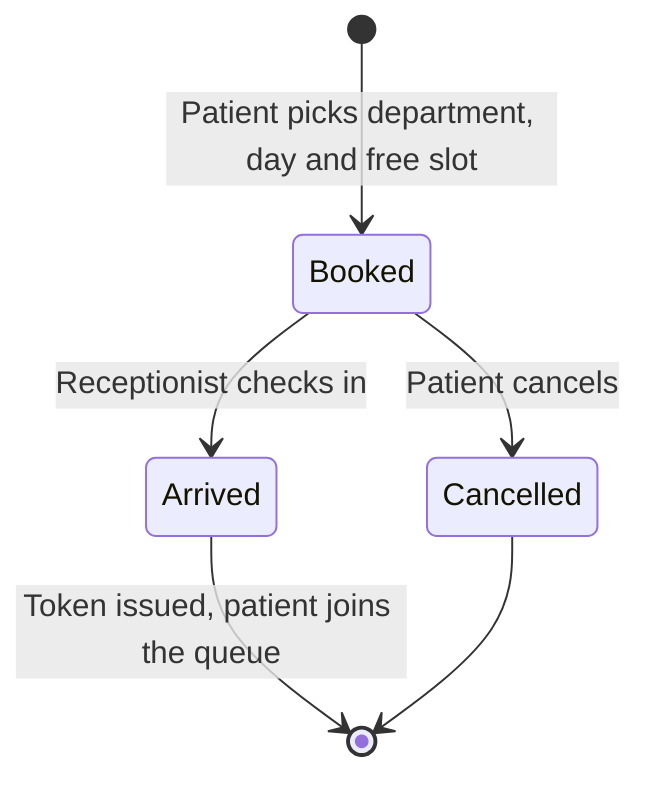

Slots run every 30 minutes from 9:00 to 12:30 and 16:00 to 18:30. Each slot takes as many bookings as the department has active doctors.

### Live analytics link

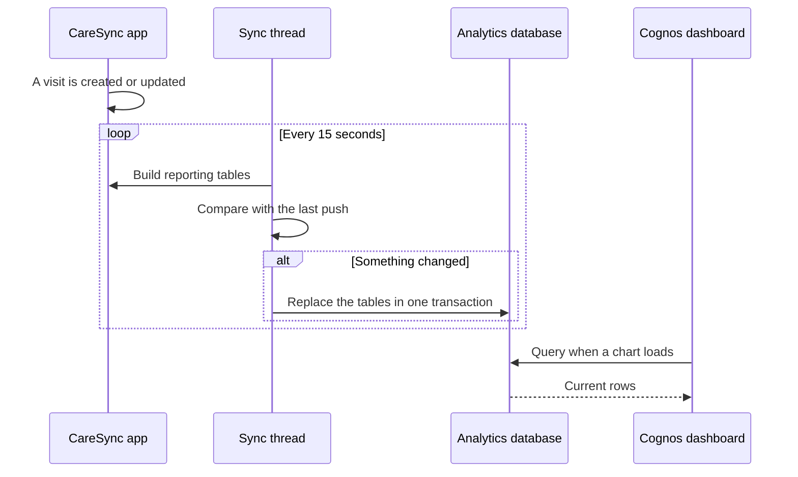

In testing, a visit created in the app appeared in the analytics database 7 seconds later.

## Data model

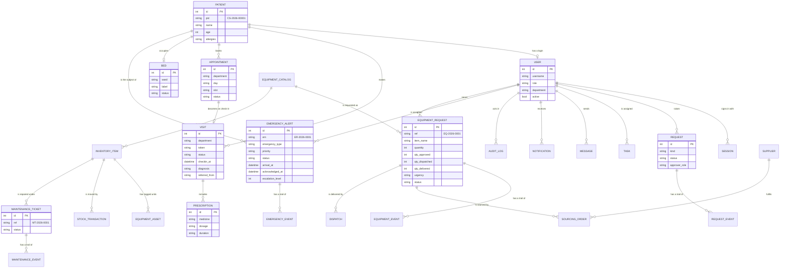

## IBM services

| Service | Use in the app | Status |
|---|---|---|
| watsonx.ai | Summarises a patient's history for the doctor; suggests a department from the reason for the visit | Working when `WATSONX_APIKEY` and `WATSONX_PROJECT_ID` are set. Without them the app uses rule-based fallbacks and labels them as such. |
| Cognos Analytics | Dashboard for the dean and chairman, embedded on the Analytics page | Working. Cognos reads the analytics database through a data server connection. |
| Db2 on Cloud | App database | Supported through `DATABASE_URL`, not tested against a live instance. |

Only the reason text is sent to watsonx.ai for department suggestions, never the patient's name or ID.

### Connecting Cognos to live data

1. Create a cloud PostgreSQL database and set `ANALYTICS_DATABASE_URL`. The app creates a `caresync` schema with `visits`, `beds`, `requests` and `appointments` tables.
2. Create a read-only database user with `SELECT` on that schema.
3. In Cognos: **Manage > Data server connections > PostgreSQL**, sign on as the read-only user, then load the `caresync` schema.
4. Create a data module from the four tables. Set `wait_minutes` and `consult_minutes` to aggregate by **Average**.
5. Build a dashboard on the data module and paste its embed link under **Admin and audit** in the app.

If the database limits connections, use its transaction pooler port and add `prepareThreshold=0` to the JDBC URL.

## Run it

**Windows:** double-click `run.bat`.

**Any platform:**

```bash
python -m pip install -r requirements.txt
python -m uvicorn app.main:app --port 8000
```

**Docker:**

```bash
docker run --rm -p 8000:8000 ghcr.io/abishekss2007/caresync:latest
```

The image is published by the CI/CD workflow. GitHub packages start private, so either make the package public in its settings or run `docker login ghcr.io` first.

Open http://localhost:8000. In demo mode the sign-in page lists every sample account; click one to open that workspace. Each browser tab keeps its own sign-in, so several roles can be shown side by side.

`DEMO.md` has a five-minute walkthrough.

## Deployment

The demo runs on [Render](https://render.com) as one Python web service that serves both the front end and the API.

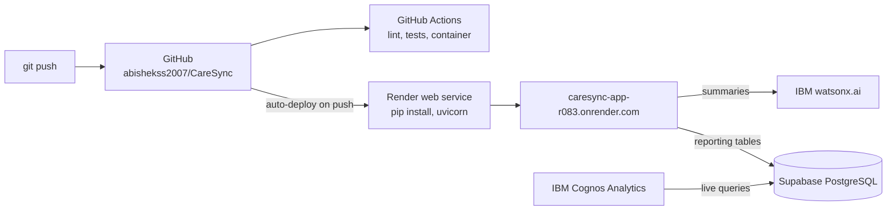

| Setting | Value |
|---|---|
| Build command | `pip install -r requirements.txt` |
| Start command | `python -m uvicorn app.main:app --host 0.0.0.0 --port $PORT` |
| Environment | `DEMO_MODE=1`, `PYTHON_VERSION=3.12.7`, `TZ=Asia/Kolkata`, plus the watsonx.ai, analytics and Cognos variables below |

Secrets are set in the Render dashboard and are never committed. The app database is SQLite inside the service, so demo data starts fresh on every restart. The same `Dockerfile` also runs on any container platform that provides a `PORT`, such as IBM Cloud Code Engine.

## Configuration

Copy `.env.example` to `.env`. Everything is optional; with no `.env` the app runs on a local SQLite file with demo data.

| Variable | Purpose |
|---|---|
| `DEMO_MODE` | `1` (default) shows one-click demo accounts and rebuilds sample data each day. Set `0` for real use. |
| `DEMO_PASSWORD` | Password shared by the demo accounts. Change it from the default in `app/seed.py`. |
| `WATSONX_APIKEY`, `WATSONX_PROJECT_ID` | IBM Cloud API key and watsonx.ai project |
| `WATSONX_URL`, `WATSONX_MODEL` | Region endpoint and model ID |
| `DATABASE_URL` | App database. Empty means local SQLite. |
| `ANALYTICS_DATABASE_URL` | Cloud PostgreSQL that Cognos reads |
| `ANALYTICS_SYNC_SECONDS` | How often the sync checks for changes (default 15) |
| `COGNOS_DASHBOARD_URL` | Embed link of the Cognos dashboard |
| `TZ` | Server timezone. The app stores local wall-clock times, so set this to the hospital's timezone when hosting (for example `Asia/Kolkata`). |
| `LIVE_CHECK_SECONDS` | How often the watchdog checks emergency escalation, alert retries and equipment reminders (default 10) |

`.env` is ignored by git. Never commit it.

## Tests and CI/CD

`tests/smoke.py` runs 82 checks against a running server: who can and cannot reach each endpoint, and each workflow end to end (registration, tokens, vitals, consultation, referral, approvals, tasks, messages, appointments, staff accounts, beds, analytics, audit).

```bash
python -m uvicorn app.main:app --port 8000
python tests/smoke.py
```

Run it against freshly seeded data; it creates accounts and bookings, so a second run on the same database fails.

`tests/workflows.py` checks the emergency workflow (duplicate prevention, delivery and acknowledgement tracked separately, escalation, restricted details, status order) and the equipment workflow (approval, stock checks, concurrent reservations, partial fulfilment, returns, unsafe maintenance). Start the server with `LIVE_CHECK_SECONDS=2` on a fresh database, then run `python tests/workflows.py`.

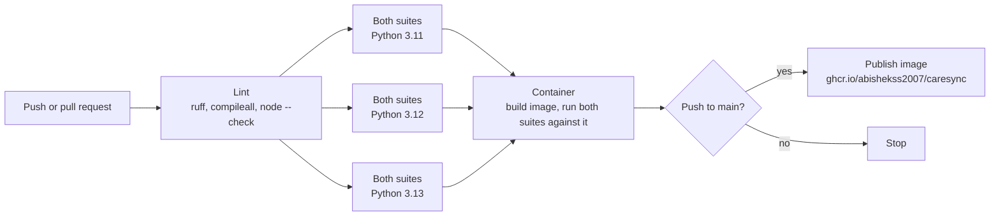

The workflow is in `.github/workflows/ci.yml`. It runs on every push and pull request; each test job starts the server on fresh demo data, runs `tests/smoke.py` and then `tests/workflows.py`. CI runs with no cloud services: watsonx.ai falls back to rules and the analytics sync is off.

## Project layout

```
app/
  main.py            API, access rules, workflows
  db.py              models and database setup
  seed.py            synthetic demo data
  ai.py              watsonx.ai calls and rule-based fallbacks
  reporting.py       de-identified reporting tables
  analytics_sync.py  live copy to the analytics database
  emergency.py       critical emergency alerts, escalation and audit
  equipment.py       equipment requests, stores, sourcing, dispatch, maintenance
  catalog.py         equipment catalogue by section and category
  live.py            live update stream and background watchdog
static/
  index.html, app.js, styles.css   the single-page front end
  favicon.ico, logo-mark.png       app icon and logo
tests/smoke.py       end-to-end checks
tests/workflows.py   emergency and equipment workflow checks
DEMO.md              demo script
Dockerfile           container image
```

## Limits

- **Demo software.** It has not had a security or clinical safety review and must not hold real patient data as it stands.
- **Demo mode** allows one-click sign-in and rebuilds the data daily. Turn it off for anything beyond a demo.
- **AI suggestions are aids.** The department suggestion is a routing hint for the front desk and the history summary is a reading aid. Neither is a diagnosis.
- **Demo hosting.** The hosted instance is on a free plan: it sleeps when idle and its data resets on restart.
- **One timezone.** Times are stored as the server's local time, so the server and its users should share a timezone.
- **Cognos embedding** needs the viewer to be signed in to Cognos in the same browser, and the first load can take over a minute.
